<p align="center">
  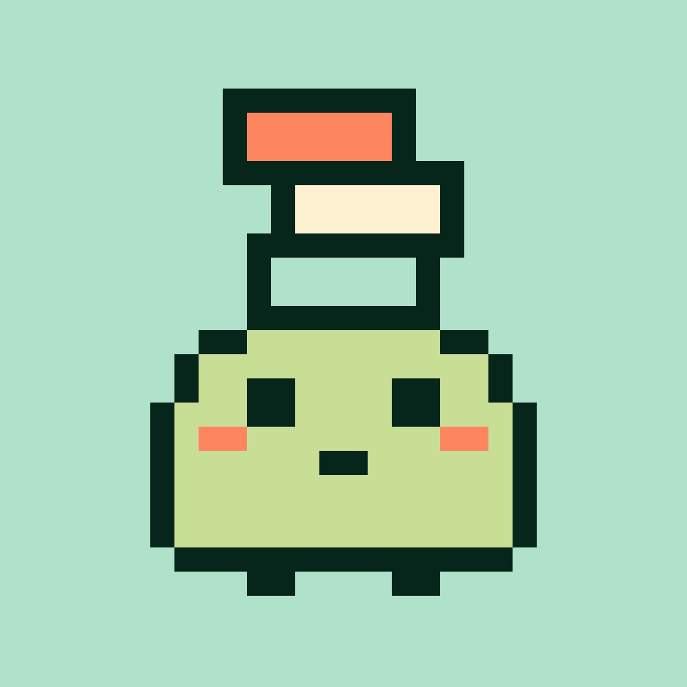
</p>

<h1 align="center">차곡차곡</h1>

<p align="center">
스스로 정한 목표에 스티커를 붙이고, 쌓인 판을 다시 보며 성취감을 얻는 개인 기록 앱
</p>

<p align="center">
  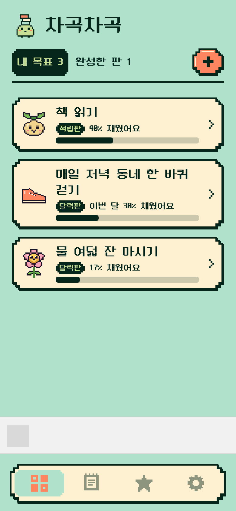
  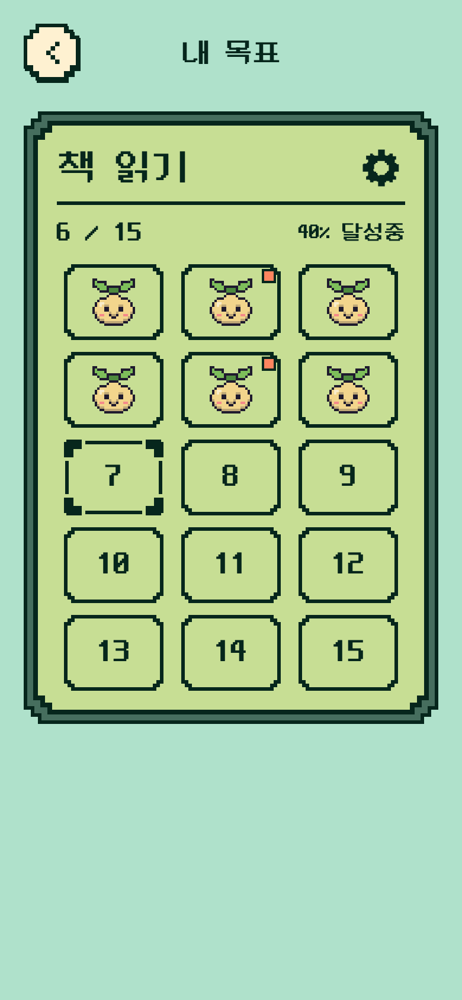
  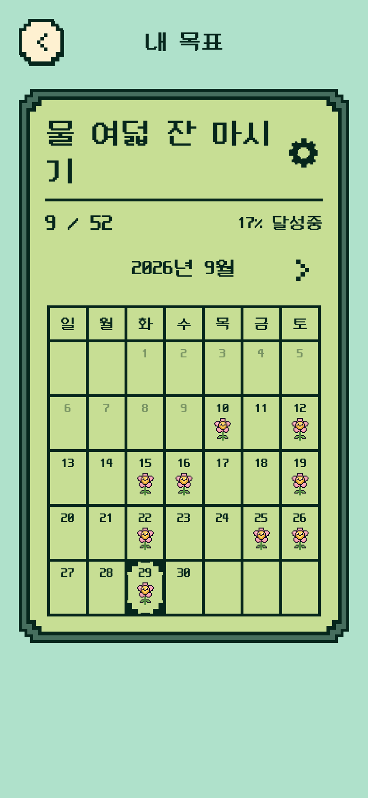
  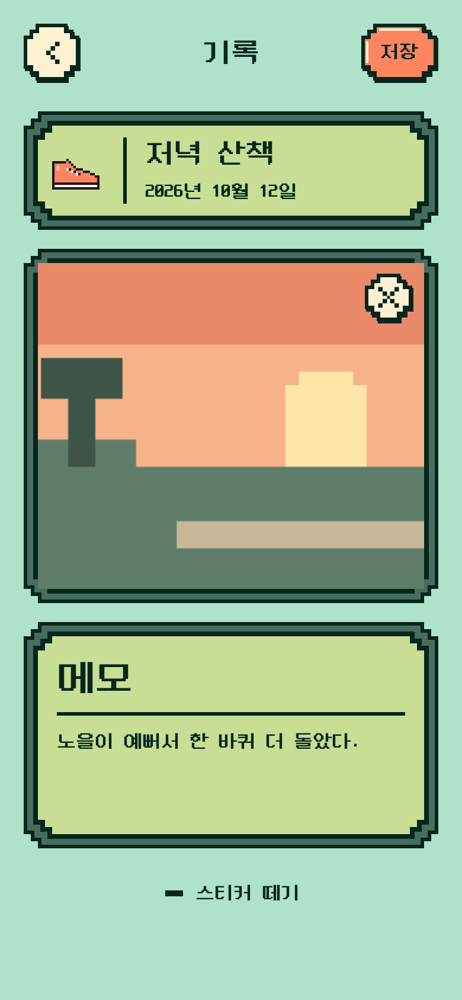
  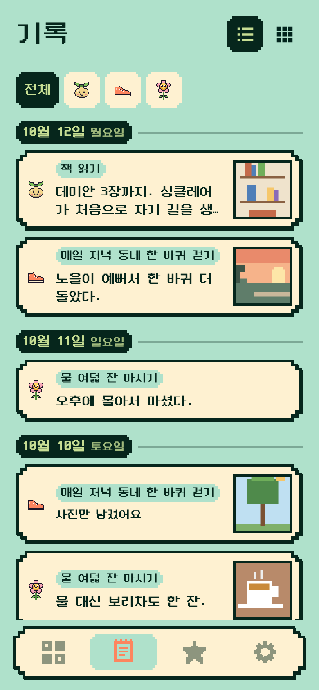
  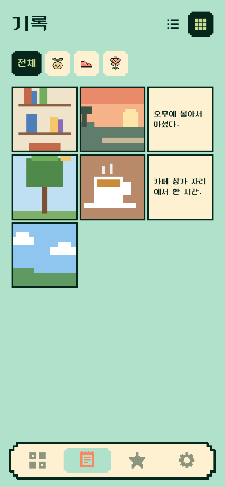
  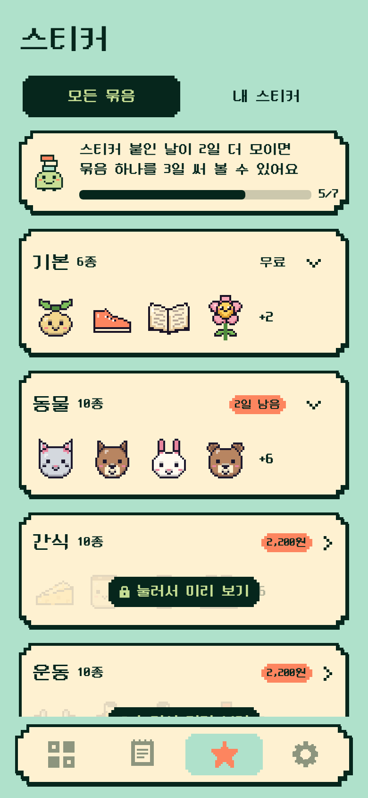
</p>
<p align="center"><sub>앱: 목표 탭, 적립판, 달력판, 기록 화면, 기록 탭(목록, 피드), 스티커 탭. Storybook에서 실제 컴포넌트를 렌더한 화면</sub></p>

<p align="center">
  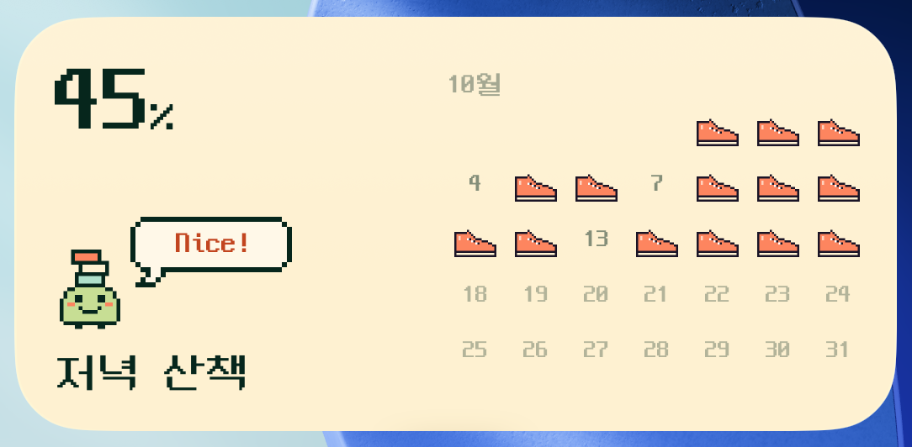
  &nbsp;
  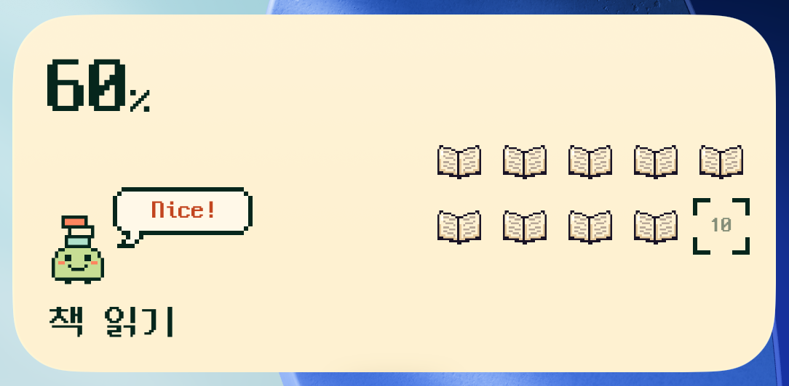
</p>
<p align="center"><sub>홈 화면 위젯: 이번 달(달력판), 적립판. 앱을 열지 않고 위젯에서 바로 붙인다</sub></p>

<p align="center">
  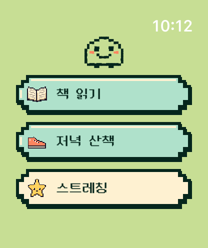
  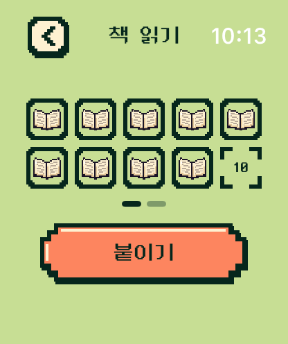
  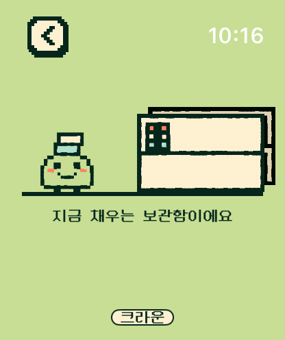
  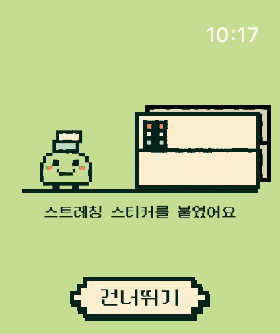
</p>
<p align="center"><sub>Apple Watch: 목표 목록, 붙이는 판, 차곡이와 보관함, 붙일 때 모션(세 번째 블록이 떨어지면 걸어가 보관함에 넣는다). iOS, watchOS 시뮬레이터 화면</sub></p>

---

## 이 프로젝트로 넓혀 본 것

차곡차곡은 개인적으로 진행하는 프로젝트다. 매일 쓸 만한 작은 앱 하나를 끝까지 만들면서, **평소 다뤄 보지 않았던 영역을 하나씩 직접 부딪쳐 보는 것**이 목표다. 화면 몇 장짜리 데모에서 멈추지 않고, 앱 밖(홈 화면, 손목)으로 나가는 기능과 스토어에 낼 때 필요한 일까지 실제로 해 본다.

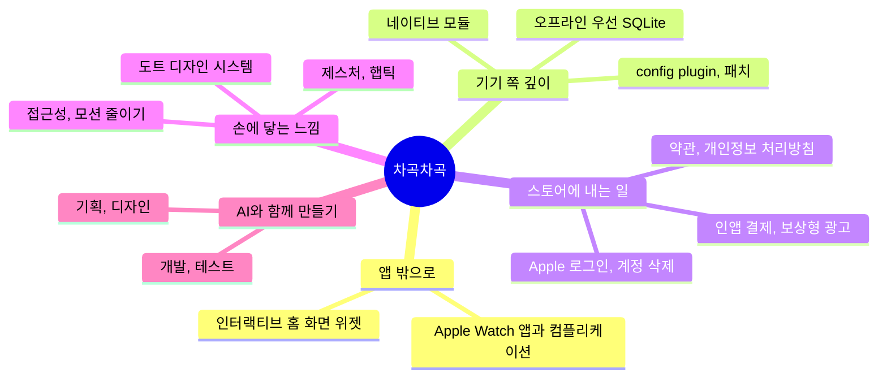

| 영역 | 이 앱에서 해 본 것 |
| --- | --- |
| 앱 밖에서 동작하는 기능 | 앱을 열지 않고 위젯에서 스티커를 붙이고 떼는 iOS 인터랙티브 위젯, 폰과 주고받는 Apple Watch 앱과 시계 화면 컴플리케이션 |
| 기기 쪽 코드 | WatchConnectivity 네이티브 모듈, 위젯 편집 화면을 위한 Expo config plugin, 라이브러리 패치, 개발 빌드를 실기기에 직접 서명해 설치 |
| 오프라인 우선 데이터 | 기기 SQLite를 원본으로 두고 변경 대기열로 백업, 복원 충돌은 사용자가 고르게, 시간대가 바뀌어도 날짜가 밀리지 않게 |
| 스토어에 내기 위한 일 | Apple 로그인과 토큰 폐기까지 포함한 앱 안 계정 삭제, RevenueCat 인앱 결제, AdMob 보상형 광고, 약관과 처리방침, 만 14세 미만 처리 |
| 손에 닿는 느낌 | 끌어서 고르는 탭 바, 밀어서 넘기는 탭 화면, 붙일 때 모션과 햅틱, 화면 낭독 이름과 모션 줄이기, 직접 만든 도트 디자인 시스템과 스티커 그림 생성 스크립트 |

**백엔드는 일부러 가볍게 두었다.** 서버는 Supabase(Postgres와 행 단위 권한, 인증, 사진 저장소, Edge Function 두 개)로 꼭 필요한 만큼만 쓰고, 시간과 고민은 **앱에서 할 수 있는 일**에 쏟았다. 대신 가벼운 서버로도 기록이 섞이거나 사라지지 않도록 동기화 규칙은 기기 쪽에서 꼼꼼히 설계했다([4절](#4-어떻게-만들었나)).

---

## 목차

1. [이 앱은](#1-이-앱은)
2. [AI를 어떻게 활용했나](#2-ai를-어떻게-활용했나)
3. [문제를 어떻게 푸나](#3-문제를-어떻게-푸나)
4. [어떻게 만들었나](#4-어떻게-만들었나)
5. [실행 순서](#5-실행-순서)

---

## 1. 이 앱은

독서, 산책, 운동처럼 **내가 정한 일**을 마친 순간 판에 스티커 한 칸을 붙인다. 더 남기고 싶을 때만 사진과 메모를 덧붙인다. 시간이 지나 판이 차오르면 그 판 자체가 돌아보는 기록이 된다.

### 만든 과정

작은 앱이지만 아이디어에서 출시 준비까지 한 바퀴를 모두 직접 돌았다.

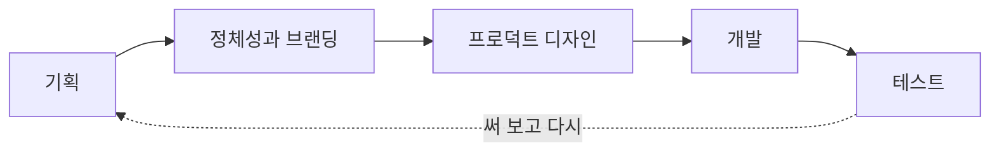

| 단계 | 한 일 |
| --- | --- |
| **기획** | 머릿속 아이디어를 구체화해 앱의 성격을 잡고, 기능과 화면 흐름을 PRD로 기획했다. 결정이 바뀔 때마다 이전 결정과 바뀐 이유를 PRD에 함께 남겨, 왜 지금 모양인지 언제든 따라갈 수 있게 했다 |
| **정체성과 브랜딩** | 앱의 톤을 정하고, 캐릭터 「차곡이」와 표정, 앱 아이콘, 스플래시를 만들었다. 화면 문구는 시스템 상태가 아니라 사용자가 할 일과 결과로 쓴다 |
| **프로덕트 디자인** | 레트로 LCD 느낌의 도트 디자인 시스템(Neo둥근모 글꼴, 도트 프레임)과 24칸 컬러 스티커 묶음을 만들었다. 화면마다 여러 안을 실제 컴포넌트로 렌더해 비교하고 골랐고, 모든 화면과 이동은 화면 흐름도로 관리하고, [Storybook](https://novum-lab-kr.github.io/chagok-app/)에서 직접 눌러 볼 수 있다 |
| **개발** | 앱, 홈 화면 위젯, Apple Watch 앱, 백업 서버, 인앱 결제와 광고까지 구현했다 |
| **테스트** | 도메인과 저장소 테스트, 컴포넌트 테스트, Swift 로직 테스트, 서버 테스트를 두고, 시뮬레이터와 실기기에서 직접 확인한다 |

### 주요 기능

| 기능 | 내용 | PRD |
| --- | --- | --- |
| 판 두 종류 | **적립판**(칸 수를 정해 채우기)과 **달력판**(날짜마다 하나, 종료일은 선택) | 4.2, 4.3 |
| 한 번 탭 | 빈칸을 누르면 그 목표의 기본 스티커가 붙는다. 붙인 칸을 누르면 기록, 꾹 누르면 떼기 | 4.1, 4.5 |
| 기록 | 칸마다 사진 한 장과 메모(500자까지) | 4.5 |
| 기록 모아보기 | 하단 「기록」 탭. 날짜별 타임라인과 사진 피드를 바꿔 보고, 피드 칸을 누르면 사진과 메모를 이어 본다 | 4.13 |
| 홈 화면 위젯 | iOS 세 종류. 앱을 열지 않고 위젯에서 바로 붙이고 뗀다 | 4.10 |
| Apple Watch | 목표를 골라 붙이면 차곡이 머리 위로 블록이 쌓인다 | 4.14 |
| 스티커 묶음 | 24칸 컬러 도트 스티커 묶음. 구매, 광고 보기, 스티커 붙인 날로 열어 보기 | 4.12 |
| 백업과 복원 | 로그인하면 변경마다 자동 백업, 새 기기에서 복원. 로그인 없이도 이 기기에서 전부 쓸 수 있다 | 4.8 |

### 사용 흐름

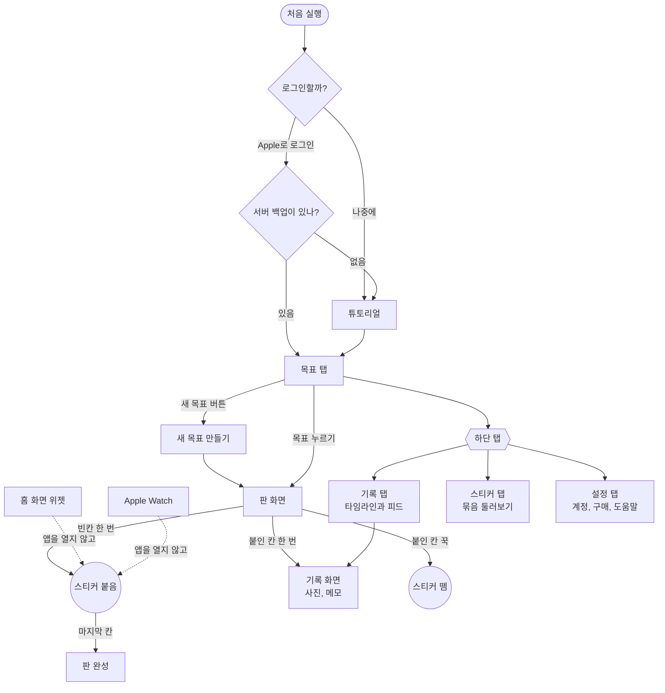

화면 전체와 이동 경로는 Storybook `Flows/앱 전체`에 실제 화면으로 깔려 있다(화면 32개, 화살표 57개). 화면마다 PRD 절 번호가 태그로 붙어 있어 기획과 화면을 오가며 볼 수 있다.

---

## 2. AI를 어떻게 활용했나

이 앱의 코드, 문서, 시안은 대부분 AI 코딩 에이전트(Claude Code)가 만들었다. 스티커 그림 일부는 다른 AI 도구(Codex)로 만든 24×24 PNG를 에이전트가 규격에 맞게 변환해 썼다. 사람은 **무엇을 만들지 정하고, 보고 고르고, 직접 써 보고 확인**한다. 핵심은 AI에게 "다 맡기기"가 아니라, AI가 잘못 가기 쉬운 지점마다 **사람이 고르는 단계와 확인하는 장치**를 둔 것이다.

### 단계마다 맡은 일

AI는 코드를 짜는 데서 끝나지 않고 기획부터 테스트까지 전 과정에 썼다.

| 단계 | AI가 맡은 일 | 사람이 맡은 일 |
| --- | --- | --- |
| 기획 | 아이디어를 질문으로 구체화해 PRD로 정리, 애매한 결정마다 선택지 세 개와 추천, 남은 결정과 바뀐 결정의 이력 관리 | 무엇을 만들지, 무엇을 넣지 않을지 정하기 |
| 디자인 | 실제 컴포넌트를 렌더한 시안 28개, 도트 스티커 생성기와 변환, 캐릭터와 아이콘 시안 | 보고 고르기, 메모로 방향 잡기 |
| 개발 | React Native, Swift, SQL, 서버 함수 구현. 작업마다 독립된 폴더에서 여러 세션이 나란히 진행 | 우선순위, 외부 계정과 설정 |
| 테스트 | 도메인 로직은 테스트 먼저, 컴포넌트 테스트, 화면을 렌더해 가로 넘침과 오류 검사, 시간대와 CPU 부하 같은 조건 재현 | 실기기에서 직접 써 보고 확인 |

### 역할 나누기

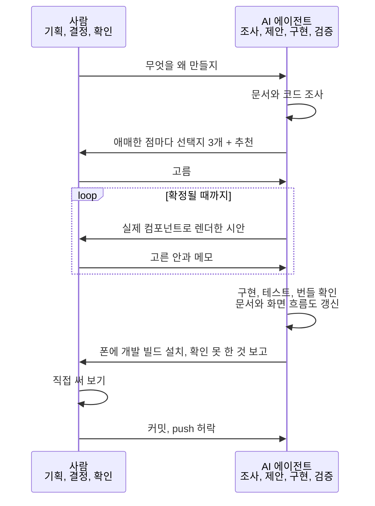

### AI가 같은 실수를 반복하지 않게 하는 장치

AI 에이전트는 세션이 끝나면 대화를 잊는다. 그래서 **배운 것을 저장소 안 문서로 남기고, 다음 세션이 그 문서부터 읽게** 했다.

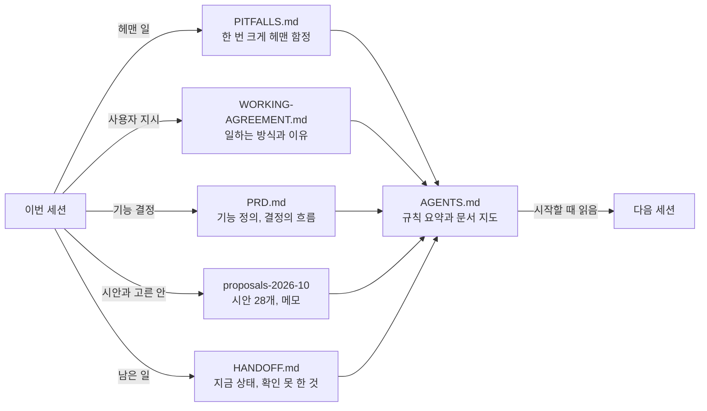

| 장치 | 왜 필요했나 |
| --- | --- |
| **선택지 3개 + 추천** | AI가 애매한 것을 임의의 값으로 채우는 것을 막는다. 사용자는 설명을 읽는 대신 고른다 |
| **시안은 아티팩트로 먼저** | 말로 "A안은 이렇고"보다 나란히 렌더한 화면이 훨씬 빨리 결정된다. 고른 안과 메모는 아티팩트 db에 저장돼 에이전트가 그대로 읽는다 |
| **실제 컴포넌트로 캡처** | 손으로 그린 목업은 실제 화면과 어긋난다. 시안도 Storybook에서 진짜 컴포넌트를 렌더해 찍는다 |
| **렌더해서 눈으로 본다** | 좌표만 계산한 도트 그림은 거의 틀렸다. 달리는 사람이 생강 쿠키로, 운동화가 슬리퍼로 나온 것을 렌더 1초 만에 알아챘다 |
| **테스트 통과는 확인이 아니다** | 커밋은 사용자가 폰에서 직접 써 본 뒤. 타입 검사가 통과해도 실제 번들까지 돌린다 |
| **작업마다 worktree** | 여러 에이전트 세션이 동시에 일한다. main 체크아웃은 함께 쓰므로 각자 자기 폴더에서만 쓴다 |
| **화면 흐름도를 같이 고친다** | 화면이 바뀌면 같은 작업 안에서 `Flows/앱 전체`도 맞춘다. 기획과 실제 화면이 멀어지지 않게 |
| **확인 못 한 것은 그대로 적는다** | "실기기 미확인"처럼 안 한 것을 한 것처럼 쓰지 않는다. HANDOFF에 모은다 |
| **쉬운 말, 사용자 쪽 문구** | 화면 문구는 시스템 상태가 아니라 할 일과 결과로("로그인이 풀렸어요" → "로그인이 필요해요") |

### 문서 지도

| 문서 | 언제 읽나 |
| --- | --- |
| [AGENTS.md](AGENTS.md) | 이 저장소에서 일을 시작할 때. 규칙 요약 |
| [docs/PRD.md](docs/PRD.md) | 기능이 어떻게 동작해야 하는지, 남은 결정, 결정의 흐름 |
| [docs/HANDOFF.md](docs/HANDOFF.md) | 지금 상태, 진행 중인 것, 확인 못 한 것 |
| [docs/DESIGN-SYSTEM.md](docs/DESIGN-SYSTEM.md) | 화면을 만들 때. 색, 글꼴, 컴포넌트, 화면 수치 |
| [docs/WORKING-AGREEMENT.md](docs/WORKING-AGREEMENT.md) | AI와 일하는 방식 전체와 그 이유 |
| [docs/PITFALLS.md](docs/PITFALLS.md) | 빌드, 테스트, 기기 확인 전에 |
| [docs/design/proposals-2026-10/](docs/design/proposals-2026-10/README.md) | 시안 원본과 고른 과정 |
| [stories/flows/README.md](stories/flows/README.md) | 화면 흐름도 고치는 법 |

---

## 3. 문제를 어떻게 푸나

### 원칙

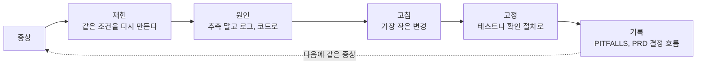

- **재현부터.** 기기가 바쁠 때만 나는 문제는 CPU 부하를 걸고 콜드 스타트를 여러 번 한다. 시간대 문제는 시뮬레이터를 다른 시간대로 띄운다.
- **타입으로 못 잡는 경계는 테스트로 묶는다.** 칸 번호 1부터와 0부터, 로컬 날짜, 같은 요청 두 번 처리 같은 것.
- **우회했으면 왜 우회했는지 적는다.** 커밋 메시지와 코드 주석에 제약과 이유를 남긴다.
- **결정이 바뀌면 이전 결정도 남긴다.** PRD에 "(이전: …)"와 날짜를 붙여, 왜 지금 모양인지 따라갈 수 있게.

새로 크게 헤맨 일은 [docs/PITFALLS.md](docs/PITFALLS.md)에 더한다. 지금 상태와 아직 확인하지 못한 것은 [docs/HANDOFF.md](docs/HANDOFF.md)에 있다.

---

## 4. 어떻게 만들었나

### 기술 스택

| 영역 | 사용한 것 |
| --- | --- |
| 앱 | Expo 57, React Native 0.86, React 19, TypeScript, expo-router |
| 기기 저장소 | expo-sqlite(WAL), 버전 단위 마이그레이션 |
| 위젯 | expo-widgets(iOS WidgetKit), 위젯 편집 「목표」를 위한 config plugin(`plugins/widget-goal`) |
| 워치 | SwiftUI 워치 앱(`targets/watch`, `@bacons/apple-targets`), WatchConnectivity 네이티브 모듈(`modules/chagok-watch`) |
| 서버 | Supabase(Postgres, Auth, Storage, Edge Functions), 행 단위 권한(RLS) |
| 결제와 광고 | RevenueCat, Google AdMob(비맞춤 배너, 보상형 광고) |
| 디자인 시스템 | 레트로 LCD 테마, Neo둥근모 글꼴, 도트 프레임 컴포넌트(`src/design-system`) |
| 검토 도구 | Storybook 10, 화면 흐름도(story-flow addon), Playwright 캡처 |
| 테스트 | jest + ts-jest(도메인, 저장소, 동기화), vitest(컴포넌트), Swift 로직 테스트, Supabase 서버 테스트 |

### 구조: 기기가 먼저, 서버는 백업

모든 기록은 **기기 SQLite가 원본**이다. 로그인하지 않아도, 오프라인이어도 앱은 그대로 동작한다. 서버는 기기를 바꿀 때 되살리기 위한 백업이다.

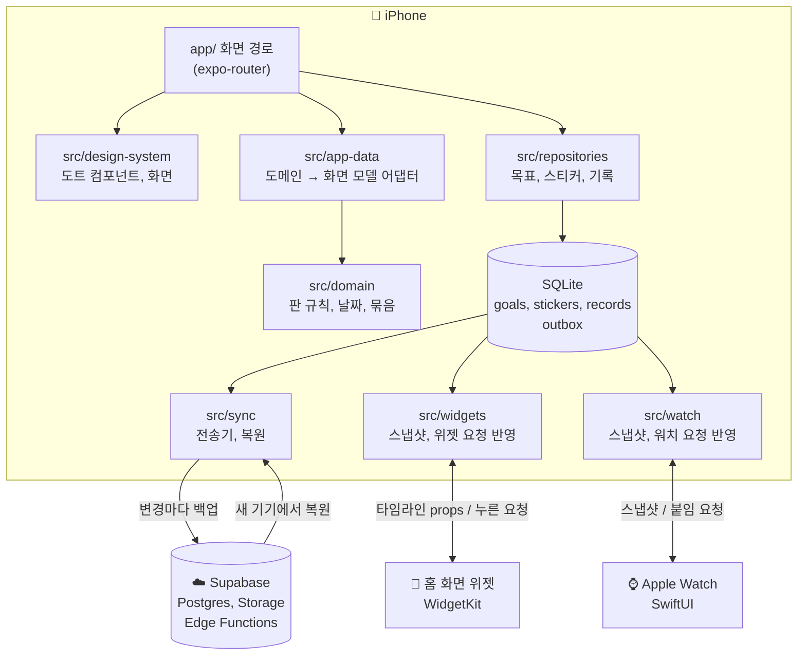

**설계에서 지킨 경계**

- **판단은 폰이 한다.** 위젯과 워치는 보여 주기와 "눌렀다"는 요청만 한다. 칸 번호, 날짜, 완성 판단은 폰 앱의 같은 코드가 한다. 그래서 규칙이 한 곳에만 있다.
- **디자인 시스템은 바꾸지 않고 어댑터로 맞춘다.** 화면은 칸 번호가 1부터, 도메인은 `slotIndex`가 0부터다. 어느 쪽을 비틀지 않고 `src/app-data/pocketAdapter.ts`가 경계를 흡수한다.
- **변경과 백업 대기열은 같은 트랜잭션에 쓴다.** 저장은 됐는데 백업 대기열에 안 들어가는 틈이 없다.

### 데이터 모델 (기기)

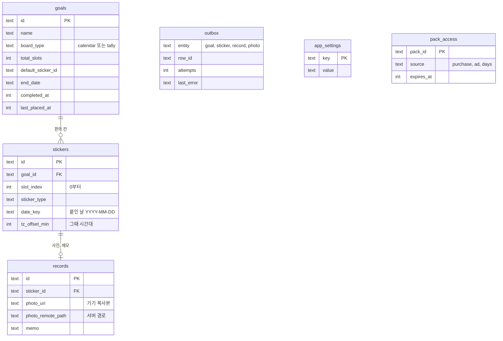

### 백업이 흐르는 길

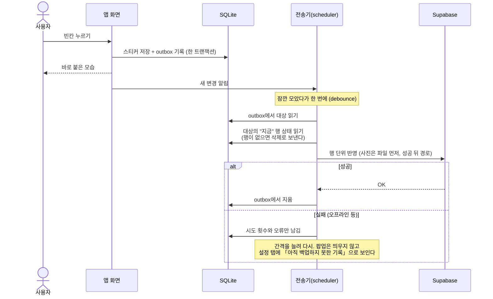

### 위젯과 워치에서 붙이기

위젯과 워치는 앱이 꺼져 있을 때도 눌린다. 그래서 누른 순간을 **요청**으로 남겨 두고, 앱이 그 요청을 누른 순서대로 반영한다.

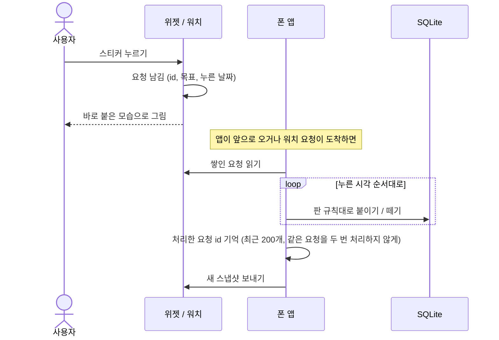

- 누른 날짜는 요청에 담긴다. 자정을 넘겨 처리해도 **누른 날**에 붙는다.
- 같은 요청이 계속 실패하면 일정 횟수 뒤 넘긴다. 실패하는 요청 하나가 뒤 요청을 모두 막지 않게.

### 폴더

```text
app/                 화면 경로 (expo-router). (tabs)는 하단 탭 네 개
src/
  design-system/     도트 프레임, 글꼴, 화면 컴포넌트. 기존 값은 바꾸지 않고 더하기만
  app-data/          도메인 → 화면 모델 어댑터, 화면용 훅
  domain/            판 규칙, 날짜, 묶음 (UI 없음, TDD)
  repositories/      SQLite 읽기 쓰기
  db/                연결, 마이그레이션
  sync/              로그인, 백업 전송, 복원, 계정 삭제
  widgets/ watch/    스냅샷 만들기, 요청 반영
  purchases/         RevenueCat, AdMob
targets/watch/       SwiftUI 워치 앱과 컴플리케이션
modules/chagok-watch WatchConnectivity 네이티브 모듈
plugins/widget-goal  위젯 편집 「목표」 config plugin
supabase/            마이그레이션, Edge Functions (Apple 연결, 계정 삭제)
stories/             Storybook 스토리, 화면 흐름도 (stories/flows)
docs/                PRD, 디자인 시스템, 인계, 함정, 시안 기록
```

---

## 5. 실행 순서

자세한 설정(Android, 실기기, 개발 서버)은 [docs/DEV-SETUP.md](docs/DEV-SETUP.md)에 있다.

**1. 의존성 설치**

```sh
npm ci
```

> `package.json`의 `overrides: { "react-dom": "19.2.3" }`는 지우지 않는다. 지우면 설치가 ERESOLVE로 실패한다.

**2. 환경 변수**

`.env.example`을 `.env.local`로 복사해 Supabase 주소와 키를 채운다. 비워 두면 로그인과 백업 없이 이 기기 전용으로 동작한다.

**3. 화면 먼저 보기 (빌드 없이)**

```sh
npm run storybook          # http://127.0.0.1:6006, 화면 흐름도는 Flows/앱 전체
```

**4. 개발 빌드 설치 (iOS 시뮬레이터)**

```sh
npx expo prebuild --platform ios --clean
npx expo run:ios --no-bundler      # 첫 빌드는 10분 넘게 걸릴 수 있다
```

네이티브 라이브러리나 `app.json`을 바꿨을 때만 다시 빌드한다. 화면 코드는 개발 서버 새로고침으로 충분하다.

**5. 개발 서버 실행**

```sh
npx expo start --dev-client --port 8081
```

**6. 바꾼 뒤 확인**

```sh
npm test                   # 도메인, 저장소, 동기화 (jest + ts-jest)
npm run test:components    # 컴포넌트 (vitest)
npm run typecheck
npm run lint               # react-hooks 규칙이 핵심
npx expo export --platform ios --output-dir /tmp/check && rm -rf /tmp/check   # 실제 번들
```
