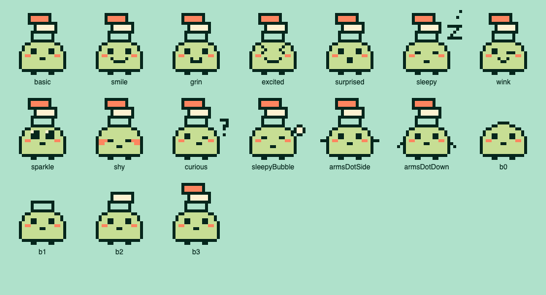

# 메인 캐릭터 「차곡이」

확정: 2026-10-03(모양) · 2026-10-04(세부). 기능 정의는 [PRD](../../PRD.md) 4.11.
시안을 고른 과정은 [시안 기록](../proposals-2026-10/README.md)에 있다.



## 모양

- 몽글이 계열: LCD 색(`#C7DE94`) 둥근 몸, 잉크(`#06261C`) 테두리, 살구(`#FD855F`) 볼, 점 눈, 발 두 개.
- 머리 위에 **책 모양 판 세 장**을 엇갈려 이고 다닌다. 아래부터 민트(`#AFE1CB`) → 아이보리(`#FEF1D1`) → 살구.
- **기본은 팔 없음.** 점 팔(발처럼 잉크 점 두 칸) 두 가지는 장면에 따라 쓰는 변형이다.
- 색은 디자인 시스템 팔레트만 쓴다. 새 색을 만들지 않는다.
- 새싹이는 기본 스티커일 뿐 캐릭터가 아니다.

## 데이터

[`character-data.json`](character-data.json)이 원본이다. 그림마다 24줄 × 24칸 문자열이고, 칸 문자는 `legend`를 따른다(`.` 투명, `#` 잉크, `g` LCD, `o` 살구, `w` 아이보리, `m` 민트).

| 묶음 | 키 | 쓰임새 (2026-10-04 확정) |
| --- | --- | --- |
| `faces` | `basic` | 기본. 앱 머리글, 평소 |
| | `smile` | 기쁨·미소. 스티커를 붙였을 때. 가장 자주 나오는 기쁨 |
| | `grin` | 기쁨·활짝. 새 목표를 만들었을 때 |
| | `excited` | 기쁨·신남. 판을 완성했을 때. 드물게 |
| | `surprised` | 놀람. 칸을 늘리거나 판을 이어 쓸 때 |
| | `sleepy` | 졸림(z + 점 두 개). 목표가 하나도 없을 때 — 첫 목표 만들기 안내(앱·위젯). **2026-10-04 확정** |
| | `wink` | 윙크. 튜토리얼을 마쳤을 때 |
| | `sparkle` | 반짝. 새 스티커·새 기능 안내 |
| | `shy` | 수줍. 사진이나 메모를 남겼을 때 |
| | `curious` | 갸웃(얼굴 옆 ?). 연결이 필요하거나 무언가 안 될 때 |
| `variants` | `sleepyBubble` | 숨방울(글자 없는 졸림). 지금은 쓰지 않고 나중에 쓸 변형 |
| | `armsDotSide`, `armsDotDown` | 점 팔 1(옆으로), 2(아래로 비스듬히) |
| `blockStates` | `b0`~`b3` | 머리 위 판 0~3장. 위젯·워치에서 쌓인 정도를 보여 줄 때 |
| `splashLayers` | `body`, `item0_mint`… | 스플래시 애니메이션 층(판 없는 몸 + 판 한 장씩) |

이름 「차곡이」와 쓰임새는 2026-10-04 확정했다(이전 가칭 「이고지고」). 화면에 붙일 때 지킬 것:

- 표정은 반응일 뿐 칭찬·평가가 아니다(PRD 2절). "잘했어요" 같은 문구와 붙이지 않는다.
- 졸림·갸웃이 재촉이나 탓하는 느낌이 되지 않게 문구와 함께 본다.
- 판 수(`blockStates`)를 숫자·순위와 붙여 점수처럼 보이게 하지 않는다.

## 그리기 규칙 (다시 그릴 때)

- 24칸 그림에서 글자 z는 **5×5**로 그린다. 4칸이면 "고"로 읽힌다(세로로 내려오는 칸이 ㄱ, 가운데 점과 아래 줄이 ㅗ). 3칸이면 I로 보인다.
- 몸 테두리 바깥에 붙는 기호(z, ?, 숨방울)는 몸 테두리와 칸이 닿지 않게 한 칸 띄운다.
- 모양 있는 팔(굵은 팔·선 팔·손만)은 몸 위쪽 모서리에 붙으면 귀처럼 보여 쓰지 않기로 했다.

## 앱 아이콘 (1안, 확정)

파일은 `node scripts/make-brand-assets.mjs`로 이 데이터에서 만든다: `assets/icon.png`(iOS 1024, 불투명), `assets/android-icon-foreground.png`·`-background.png`·`-monochrome.png`(적응형 1024, 테마 아이콘은 칠한 칸 전체 한 색), `assets/splash-icon.png`, `assets/favicon.png`. `app.json`의 `icon`·`android.adaptiveIcon`이 가리킨다.

민트 바탕 1024×1024에 기본 그림(`faces.basic`)을 칸당 36px로 그린다. 왼쪽 위 기준점은 (80, 60)이다. iOS 모서리는 시스템이 깎는다.

**Android 적응형 아이콘 (A1, 2026-10-04 확정):** 108 단위 캔버스에 민트 바탕, 같은 전신을 **칸당 2.55 단위**로 줄여 안전 영역(가운데 지름 66) 안에 넣는다. 그림 범위(4~19열, 2~22줄)의 가운데를 캔버스 가운데에 맞춘다. 원·둥근 사각형·사각형 어떤 마스크에서도 잘리지 않는다. 시안: [아이콘·스플래시 확정](https://claude.ai/artifact/4e7k1HAotEjKzYwg5k8XMV).

## 스플래시 (S2-B, 2026-10-04 확정)

- **OS 정지 화면:** 민트 바탕에 판 없는 몸(`splashLayers.body`)을 **윤곽선(`#`)만** 그린다. 칸당 7px(168px), 화면 정가운데(OS 스플래시가 그림을 가운데에 놓는다). 파일은 `assets/splash-icon.png`(504px, 칸당 21px = 3배 밀도, `imageWidth` 168).
- **앱이 이어받아 재생 (약 2.7초):**
  1. 0.2초 그대로 → 몸 10~22줄을 아래에서 위로 한 줄씩 28ms마다 색을 채운다.
  2. 0.12초 쉰 뒤 판 세 장(민트 → 아이보리 → 살구)이 위 12칸에서 2칸씩 28ms마다 떨어진다. 판이 떨어지기 시작하면 캐릭터(쌓인 판 포함)가 **두 칸씩** 받으러 간다 — 왼쪽 2칸 → 오른쪽 2칸 → 가운데. 한 칸 이동 28ms(떨어지는 중)·40ms(닿기 직전 남은 이동).
  3. 닿으면 쌓인 판 전체가 1칸 눌렸다(60ms) 돌아오고, 다음 판까지 60ms.
  4. "차곡차곡"을 한 자씩 0.1초마다 쓴다. 글자는 왼쪽부터 자리를 잡고(가운데 정렬로 밀리지 않게), 끝에 네모 커서(14×28px)가 따라오다 다 쓰면 0.16초 간격으로 두 번 깜빡인다.
- 모션 줄이기를 켠 기기는 마지막 장면만 보여 준다.
- 앱 컴포넌트: `src/design-system/splash.tsx`(`SplashAnimation`, 시간표 `splashTimeline`) — Storybook `Brand / Splash`.
- 연결 (2026-10-04): `app/_layout.tsx`가 OS 스플래시를 `preventAutoHideAsync`로 잡아 두고, 글꼴이 준비돼 애니메이션 첫 장면이 그려지면(`onLayout`) 페이드 없이 `hideAsync`, 끝나면 애니메이션을 걷는다. 앱을 처음 켤 때만 재생한다. OS 스플래시 설정은 `app.json`의 `expo-splash-screen` 플러그인(민트 바탕, `assets/splash-icon.png`, 168dp). **Expo Go는 설정한 OS 스플래시 대신 앱 아이콘을 보여 주므로**, 그림 교체와 이어짐은 개발 빌드에서 확인한다(애니메이션은 Expo Go에서도 보인다).
- 시안 원본: `../proposals-2026-10/icon-splash-final.template.html`의 `SPLASH.s2b`·`timeline()`·`drawSplash()`.

2026-10-04 메모로 바뀐 방향(기록): 빠른 S2를 바탕으로 ① OS 정지 화면은 **윤곽선만 있는 몸** ② 아래에서 위로 한 줄씩 색이 차고 ③ 판이 떨어질 때 캐릭터가 좌우로 움직여 받고 ④ "차곡차곡"을 한 자씩 쓰며 네모 커서가 따라온다. S2-A(한 칸씩, 0.06초/자)·B(두 칸씩, 0.1초/자)·C(한 칸씩, 0.028초/자) 중 **B로 확정**. 아래는 1차 「2+」 기록이다.

- OS 스플래시는 정지 그림 한 장이다. 민트 바탕에 `splashLayers.body`(판 없는 몸)만 둔다.
- 앱이 같은 자리·같은 크기(칸당 7px, 168px)에서 이어받는다.
  1. 350ms 쉰다.
  2. 판 세 장(민트 → 아이보리 → 살구)이 하나씩 떨어진다. 위 12칸에서 2칸씩 6프레임, 프레임당 45ms.
  3. 닿는 순간 쌓인 것 전체가 1칸 눌렸다가 돌아온다(70ms). 다음 판까지 150ms 쉰다.
  4. "차곡차곡"이 한 자씩 140ms 간격으로 써진다.
  5. 모두 약 2.4초다.
- 모션 줄이기를 켠 기기는 마지막 장면만 보여 준다.
- 구현은 Reanimated + `expo-splash-screen`(개발 빌드에서 OS 스플래시 교체). 움직임은 Expo Go에서도 확인할 수 있다.

## 다시 만들기

저장소 루트에서:

```sh
node docs/design/character/source/export.cjs
# → docs/design/character/character-data.json, character-sheet.html
playwright screenshot --full-page --viewport-size "924,500" "file://$PWD/docs/design/character/character-sheet.html" docs/design/character/character-sheet.png
```

`source/`는 시안 페이지에서 쓴 그리기 코드를 CommonJS 모듈로 나눈 것이다(`npm run lint` 대상).

| 파일 | 내용 |
| --- | --- |
| `base.cjs` | 픽셀 그리기 도구(`shape`, `build`, `range`, `sym`, `eyes`)와 팔레트. 2차 캐릭터 시안 5종(`CHARS2`)은 비교 기록 |
| `faces.cjs` | 확정 캐릭터의 몸·책 모양 판·표정(`carryFace`, `FACES`, 판 0~3장 `FACE_ART`) |
| `variants.cjs` | 팔·머리 위 물건 변형과 스플래시 층 분리(`carry3`, `carryBody`, `carryItem`)와 SVG 출력(`gridSvg`) |
| `export.cjs` | 위 셋으로 `character-data.json`과 시트 HTML을 만든다 |

시안 페이지 원본(`../proposals-2026-10/*.template.html`)에는 같은 코드가 한 `<script>` 안에 이어 붙어 들어 있다. 앱에 넣을 때는 이 JSON을 원본으로 삼아 `src/design-system/`에 컴포넌트로 옮긴다. 시안이 모두 확정된 뒤에 Storybook에 반영한다.
