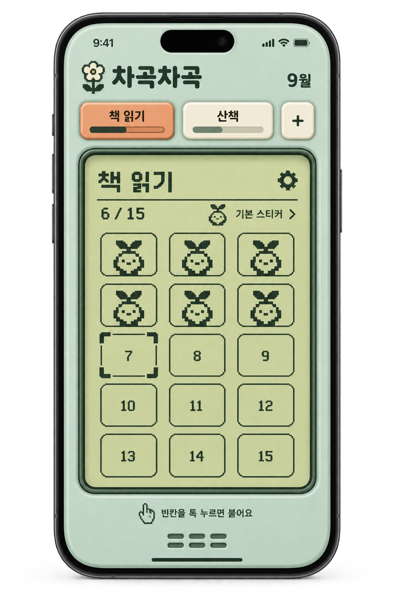
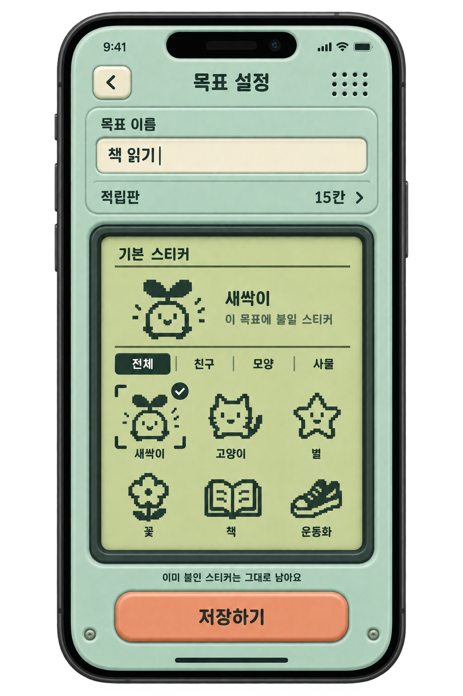
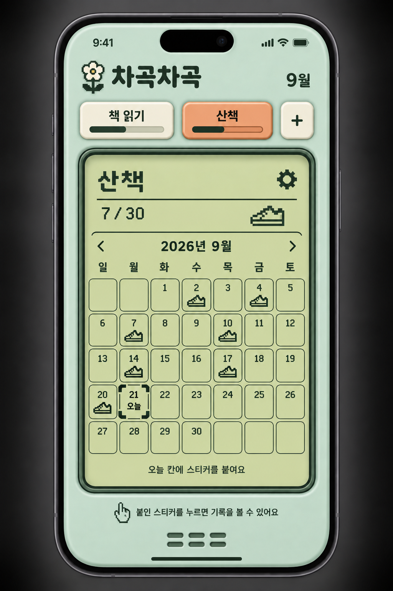
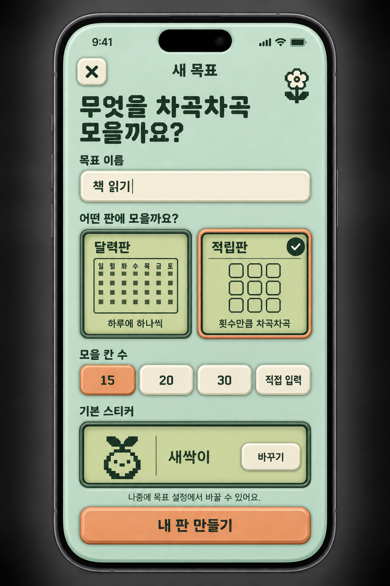
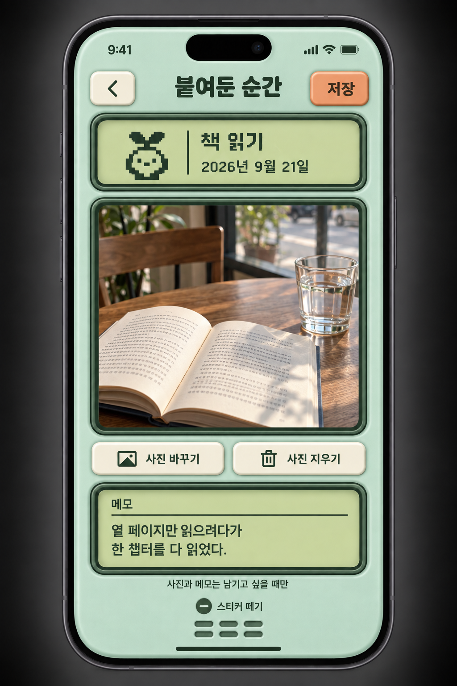

# 차곡차곡 · Retro Pocket v1

> 실제 공통 컴포넌트 검토는 [Storybook 디자인 시스템](../../DESIGN-SYSTEM.md)을 사용한다. 사용자 지정 컬러 1.1.0과 실제 Neo둥근모 적용. 이전 생성 이미지의 색은 최신 컬러 기준이 아니다.

> [전체 화면 검토본 02 · 이미지 8장](review-set-02/index.html) · [화면 목록과 확인 사항](review-set-02/README.md). 사용자 확정 전 검토본.

> **현재 외형 기준: [v6 홈](revisions/v6/screens/01-home.png). 새싹·기본 스티커 영역은 [지정 원본](revisions/v6/references/sprout-and-label-source.png)을 따른다.** `review-set-01`과 `screen-preview`는 스타일 이탈로 거절된 작업이며 기준에서 제외한다. 전체 화면은 아직 확정되지 않았다.

> **최우선 기준: [디자인 토큰 명세 1.1.0](system/DESIGN-TOKENS.md) · [tokens.json](system/tokens.json).** 값과 보관 폰트를 공통으로 사용하되, 사용자가 지정한 기준 시안의 외형을 임의로 바꾸는 근거로 삼지 않는다.

> 최신 수정: [v6 · 프레임 유지, 새싹·라벨 부분 복원](revisions/v6/README.md). 튜토리얼은 [v3](revisions/v3/README.md)를 유지한다. 아래 원본과 v2는 이전 비교 시안이다.

2026-09-21. 사용자가 선택한 세 번째 디자인 방향을 확장한 **이미지 시안 패키지**. 앱 코드는 변경하지 않았다.

## 디자인 방향

민트 플라스틱 본체, 연두색 LCD, 살구색 입체 버튼, 오리지널 픽셀 스티커.
다마고치 등 1990년대 휴대용 전자 장난감의 촉감을 참고하지만, 캐릭터를 돌보는 게임은 아니다.
스스로 정한 목표에 스티커를 붙여 모으는 기존 제품 목적을 유지한다.

## 화면

| 시안 | 내용 | 상태 |
| --- | --- | --- |
| [01 · 적립판 홈](screens/01-home-tally.png) | 목표 칩, 진행 막대, 3열 적립판 | 사용자가 선택한 원본 |
| [02 · 목표 설정](screens/02-goal-settings.png) | 이름 및 목표별 기본 스티커 | 사용자가 선택한 원본 |
| [03 · 달력판 홈](screens/03-home-calendar.png) | 7열 달력, 오늘 칸 강조, 월 이동 | 이번 확장 제안 |
| [04 · 새 목표](screens/04-new-goal.png) | 이름, 판 종류, 칸 수, 기본 스티커 | 이번 확장 제안 |
| [05 · 스티커 기록](screens/05-sticker-record.png) | 실제 색상 사진, 선택적 메모, 떼기 | 이번 확장 제안 |

### 01 · 적립판 홈

### 02 · 목표 설정

### 03 · 달력판 홈

### 04 · 새 목표

### 05 · 스티커 기록

## 합의된 UX

- 상단 칩은 목표 이름 + 작은 진행 막대. 칩을 눌러 판을 전환한다.
- 하단에 상시 스티커 팔레트를 노출하지 않는다.
- 목표 설정에서 기본 스티커를 고른다. 빈칸을 누르면 바로 붙인다.
- 기본 스티커를 바꿔도 이미 붙인 스티커는 그대로 보존한다.
- 붙인 스티커를 누르면 선택적으로 사진과 메모를 남긴다.
- 평가, 등급, 연속일수, 통계, 보상, 캐릭터 육성 요소는 넣지 않는다.

[디자인 기준](DESIGN.md) · [화면 흐름 및 상태](UX.md) · [생성 프롬프트](prompts/README.md)

## 검토 범위

이미지에서 전체 스타일, 계층, 한국어 주요 문구와 달력 날짜 배열을 육안 검토했다.
생성 이미지는 픽셀 단위 구현 명세가 아니며, 실제 휴대폰에서 터치·스크롤·키보드·글자 확대를 검증한 상태는 아니다.
미세한 픽셀 캐릭터 형태, 버튼 질감, 테두리 두께 차이는 구현 시 공통 컴포넌트로 통일한다.
원본 01·02는 승인 기록 보존을 위해 덮어쓰지 않는다. 수정 시 v2 파일을 추가한다.

## 타이포그래피 확장안

[홈 · 도트 글씨 v2](screens/01-home-tally-type-v2.png)

브랜드, 목표 칩, 월, LCD 제목과 짧은 라벨, 진행 숫자를 한글 비트맵 스타일로 통일했다.
긴 안내문과 OS 상태바는 읽기 쉬운 기존 글씨를 유지한다.
이미지 생성 도구로 편집한 방향성 시안이며 실제 폰트 파일 적용이나 폰트 선정은 아직 하지 않았다.
기존 원본을 보존하고 별도 v2 이미지로 저장했다.
