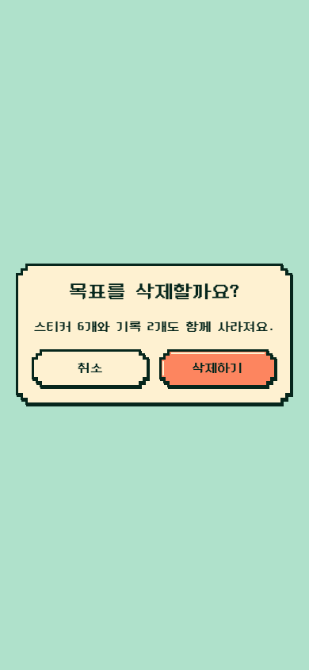

# 일반 화면 다이얼로그

같은 `PixelDialog`의 `basic` 변형 시안이다. 튜토리얼용 `tutorial` 변형에서 단계 숫자와 구분선을 빼고, 제목·설명 텍스트는 중앙 정렬한다. 글씨와 버튼 구성은 공유한다. Storybook의 [Components / Dialog / 일반 화면 · 중앙](http://localhost:6006/?path=/story/components-dialog--basic)에서 확인할 수 있다.

| 390px | 320px |
| --- | --- |
|  |  |

일반 화면에서는 다이얼로그 **박스도 화면 가로·세로 중앙**에 배치한다. `PixelDialog`는 표면 컴포넌트이며 실제 Modal 호스트의 배경 차단·포커스·닫기 동작은 화면 연결 단계의 작업이다. 캡처 검사는 `node scripts/review-basic-dialog.mjs`로 다시 실행한다.
