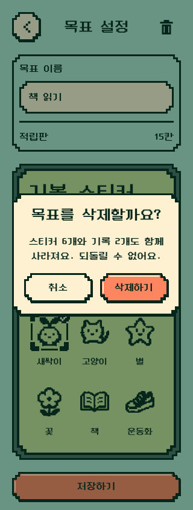
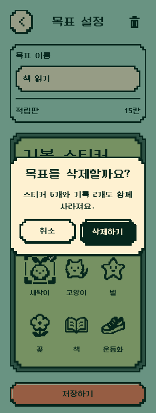
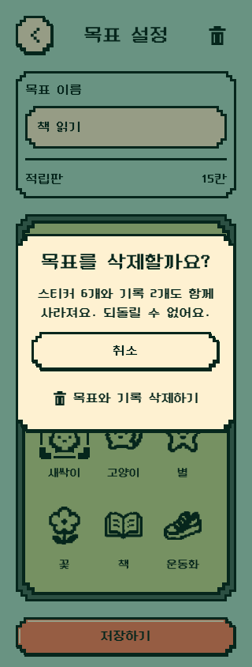
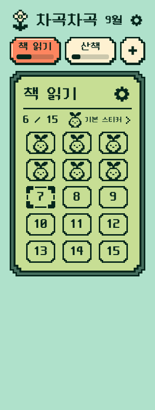
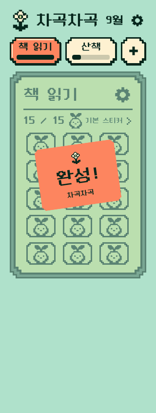
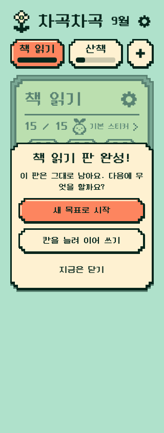
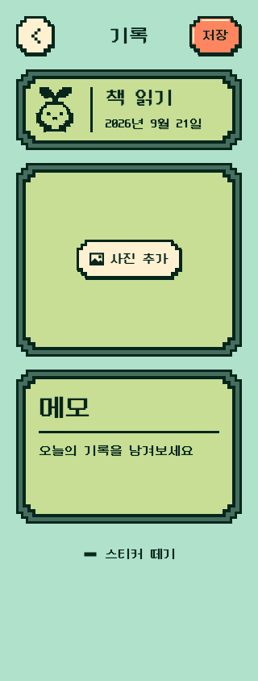

# PRD 추가 화면 설계 시안

2026-09-28 · [PRD 4.2–4.9, 7–9절](../../../PRD.md) · [구현 현황](../../../HANDOFF.md)

기존 `HomeScreen`·`GoalEditorScreen`·`RecordScreen`·`TutorialScreen`을 바탕으로 만든 **검토용 시안**이다. 화면에 필요한 요소는 선택 prop으로 추가했고 기존 디자인 시스템 토큰과 앱 라우트는 바꾸지 않았다. Storybook의 **Screens / PRD additions · proposals**에 40개 장면이 있다. 사용자 지정 방향은 아래처럼 반영했으며 앱 연결 완료나 전체 화면의 최종 승인을 뜻하지 않는다.

```sh
npm run storybook
# http://localhost:6006/?path=/story/screens-prd-additions-%C2%B7-proposals--confirm-a
```

각 장면을 100% 배율, DPR 1의 390×844와 320×844에서 캡처했다. [전체 결과](verification.json)에 렌더 오류·가로 넘침 확인값과 모든 캡처 파일명이 있다. 아래 이미지는 320px 화면이다.

## 반영한 화면 방향

### 1. 삭제 확인 다이얼로그

| A · 일반 화면 다이얼로그 | B · 어두운 삭제 버튼 | C · 분리한 삭제 액션 |
| --- | --- | --- |
|  |  |  |

A는 `PixelDialog variant="basic"`을 쓴다. 같은 컴포넌트의 튜토리얼 변형에서 단계 숫자와 구분선을 빼고 제목·설명 텍스트를 중앙 정렬하며, 다이얼로그 박스도 화면 중앙에 놓는다. 글씨·버튼 스타일은 공유한다. B는 위험 동작 버튼이 더 뚜렷하지만 디자인 시스템에 버튼 스타일을 **추가**해야 한다. C는 기존 `TextAction` 표현을 쓰되 삭제 행동의 무게가 약할 수 있다. 목표 삭제 확인에는 삭제되는 스티커·기록 개수를 보여준다. 기록이 있는 스티커를 뗄 때도 같은 확인 방식을 적용한다.

### 2. 적립판과 튜토리얼



7번 칸만 기존 `PixelFocusRing`으로 강조한다. 아래 설명 상자는 없앴고, 8번 이후의 모든 빈칸도 누를 수 있다. [튜토리얼 3단계](튜토리얼-3-빈칸-선택-320.png)는 별도 화면 조합 대신 기존 `TutorialScreen`의 스포트라이트를 사용하며 문구만 “어느 빈칸이든 누르면 스티커가 붙어요”로 맞췄다.

### 3. 판 완성과 기록

| 큰 중앙 도장 | 다음 선택 다이얼로그 | 기록 화면의 사진·메모 |
| --- | --- | --- |
|  |  |  |

마지막 칸을 붙이면 판을 흐리게 하고 가운데에 큰 도장을 찍는다. 그 다음 적립판의 “새 목표로 시작 / 칸을 늘려 이어 쓰기 / 지금은 닫기”를 숫자·구분선 없는 **화면 중앙 다이얼로그**로 보여준다. 닫은 뒤에는 [완성 판 아래의 버튼](완료-선택지-다시-열기-320.png)으로 다시 열 수 있다. [칸 늘리기](완료-뒤-칸-늘리기-320.png)는 기존 칸 수보다 큰 값만 받는다. [달력판](달력판-이달-완성-도장-320.png)은 이달 완성 도장만 남기고 적립판용 선택지는 보여주지 않는다. 큰 도장의 글자 조합은 시안이며 별도 그래픽 자산은 아직 확정하지 않았다.

기록 화면은 기존 사진·요약·메모 구성을 유지한다. 메모는 항상 입력할 수 있고 별도 쓰기 버튼은 없다. 사진이 없을 때는 프레임 안에 [추가 버튼](기록-사진-없음-프레임-안-추가-320.png), 사진이 있으면 [오른쪽 위 `×` 삭제 버튼](기록-사진-있음-오른쪽-위-삭제-320.png)을 둔다. 첨부 상태의 그림은 실제 사진 대신 자리 표시다. 기록이 있는 스티커를 떼거나 저장하지 않은 채 나가려는 경우는 [확인 다이얼로그](기록-떼기-확인-320.png)로 보여준다. 판 아래에 놓였던 설명 상자는 제거했다.

### 4. 설정의 두 진입점


앱 최상단 톱니바퀴는 **앱 설정**이다. 판 제목 옆 기존 톱니바퀴는 **목표 설정**이고, [목표 설정 화면](목표-설정-삭제-진입-320.png)에서 이름·기본 스티커를 수정하거나 상단 삭제 동작으로 목표를 지운다. 판 아래나 목표 칩 아래에 앱 설정 버튼을 추가한 안은 사용하지 않는다.

## 나머지 화면과 상태

기록 표식은 선택한 [B안 모서리 사각형](기록-표식-B-사진-또는-메모-320.png)이다. **붙인 칸**에 사진이나 비어 있지 않은 메모 중 하나라도 있을 때만 표시한다. 예시의 2번은 메모만, 5번은 사진만 있고, 내용이 없는 6번에는 표시하지 않는다.

[복원 충돌 화면](복원-두-기록-선택-320.png)은 목표 생성의 판 종류 선택처럼 두 기록을 나란한 선택 카드로 보여준다. 선택한 카드에 주황 테두리와 체크를 두고, 질문·경고는 카드 밖에 배치한다. 아래 버튼은 선택한 기록에 맞춰 문구가 바뀐다.

| 묶음 | 캡처 |
| --- | --- |
| 로컬 목표/기록 | [목표 삭제 진입](목표-설정-삭제-진입-320.png) · [기록 있는 스티커 떼기](기록-떼기-확인-320.png) · [기록 없는 스티커 떼기](기록-없음-바로-떼기-320.png) |
| 첫 사용과 경계 상태 | [목표 없음](목표-없음-첫-화면-320.png) · [긴 이름](긴-목표-이름-칩-검토-320.png) · [사진 권한 거부](사진-권한-거부-320.png) · [사진 유실](사진-유실-기록-유지-320.png) · [저장 안 한 입력](저장-안-한-입력-나가기-320.png) |
| 계정 시작 | [로그인 권유](계정-첫-실행-로그인-권유-320.png) · [만 14세 확인](계정-만-14세-확인-320.png) · [14세 미만 로컬 사용](계정-14세-미만-320.png) |
| 앱 설정/백업 | [연결됨](앱-설정-연결-상태-320.png) · [계정 없음](앱-설정-계정-없이-사용-320.png) · [오프라인](앱-설정-오프라인-백업-대기-320.png) · [짧은 알림](공통-알림-백업-대기-320.png) |
| 복원 | [충돌 선택](복원-두-기록-선택-320.png) · [진행](복원-진행-320.png) · [실패](복원-실패-320.png) |
| 로그아웃/삭제 | [백업 중](로그아웃-백업-중-320.png) · [백업 실패](로그아웃-백업-실패-320.png) · [삭제 내용](계정-삭제-내용-확인-320.png) · [최종 확인](계정-삭제-최종-확인-320.png) · [완료](계정-삭제-완료-320.png) · [네트워크 실패](계정-삭제-네트워크-실패-320.png) |
| 정책 | [약관과 라이선스](약관과-라이선스-목록-320.png) · [라이선스 상세](라이선스-상세-320.png) |

Apple·Google 로그인 버튼 영역은 배치 확인을 위한 자리 표시다. 실제 구현에는 각 회사의 공식 버튼을 넣고 브랜드 가이드를 따른다. 법적 문구는 시안에 넣지 않았으며, 약관·처리방침의 앱 내 보기와 외부 웹 열기 방식도 아직 결정하지 않았다. 계정 삭제 뒤 이 기기 기록 처리, 로그인 권유와 튜토리얼 순서, 긴 목표 이름 처리, 칸 수 상한은 PRD의 미확정 항목으로 남긴다.

이 시안은 정지 화면이다. 완성 모션 시간·감속 방식, 튜토리얼의 실제 타깃 측정, 로딩의 움직임, 토스트 지속 시간은 구현 전에 별도로 확정해야 한다. Storybook 버튼은 흐름 표시에 사용했으며 저장소나 인증과 연결되지 않는다. 기존 `CalendarBoard`의 월 제목은 320px에서 두 줄로 접힌다. 이 시안에도 그대로 보이며 달력판을 구현할 때 별도 적응성 검토가 필요하다.

## 다시 렌더하기

```sh
npm run storybook
node scripts/review-prd-additions.mjs /opt/homebrew/lib/node_modules/playwright/index.mjs
```

Playwright는 프로젝트 의존성이 아니다. 다른 설치 위치라면 스크립트 인자로 모듈 경로를 넘긴다. 스크립트는 각 장면의 390px·320px 캡처와 `verification.json`을 갱신하고, 브라우저 오류·빈 렌더·가로 넘침이 있으면 실패한다.
