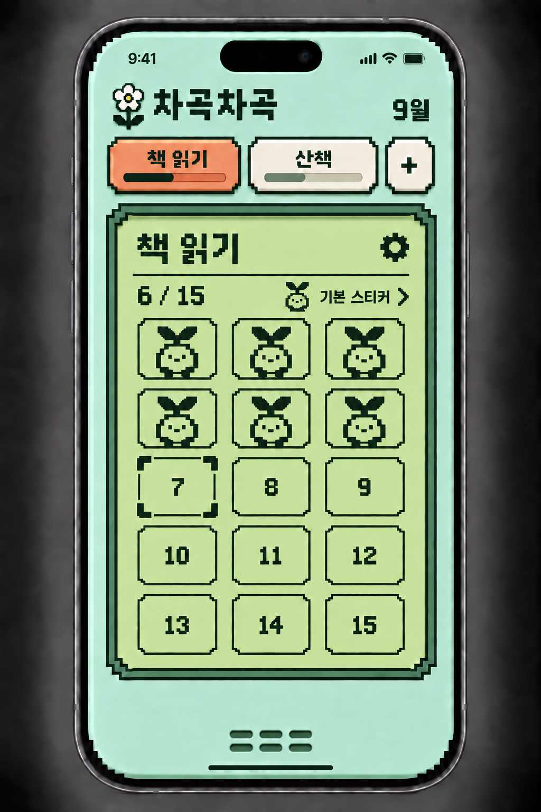
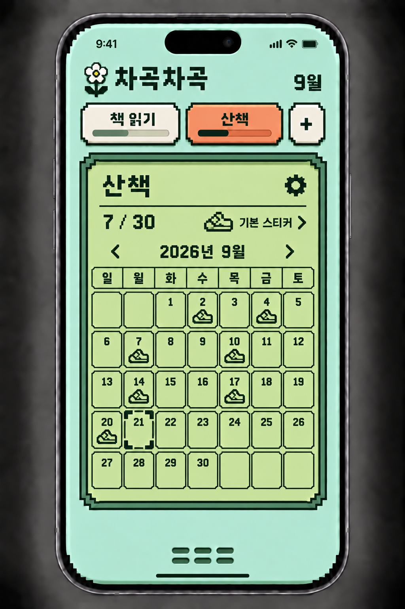
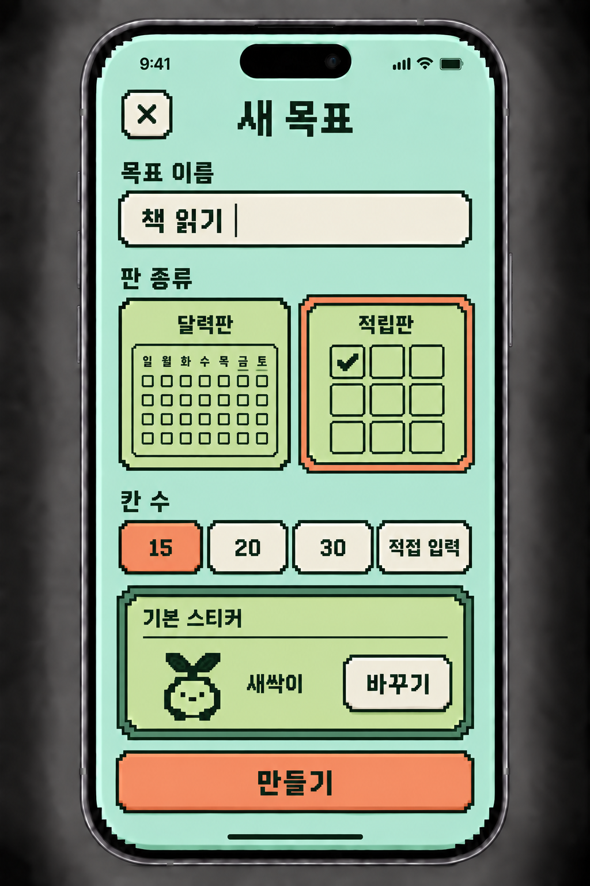
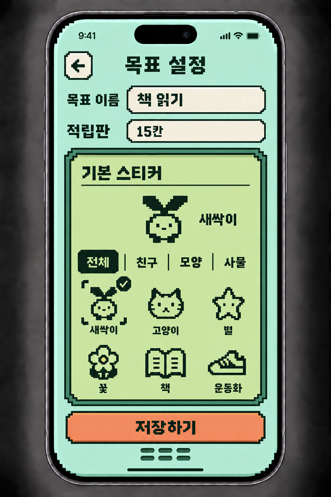
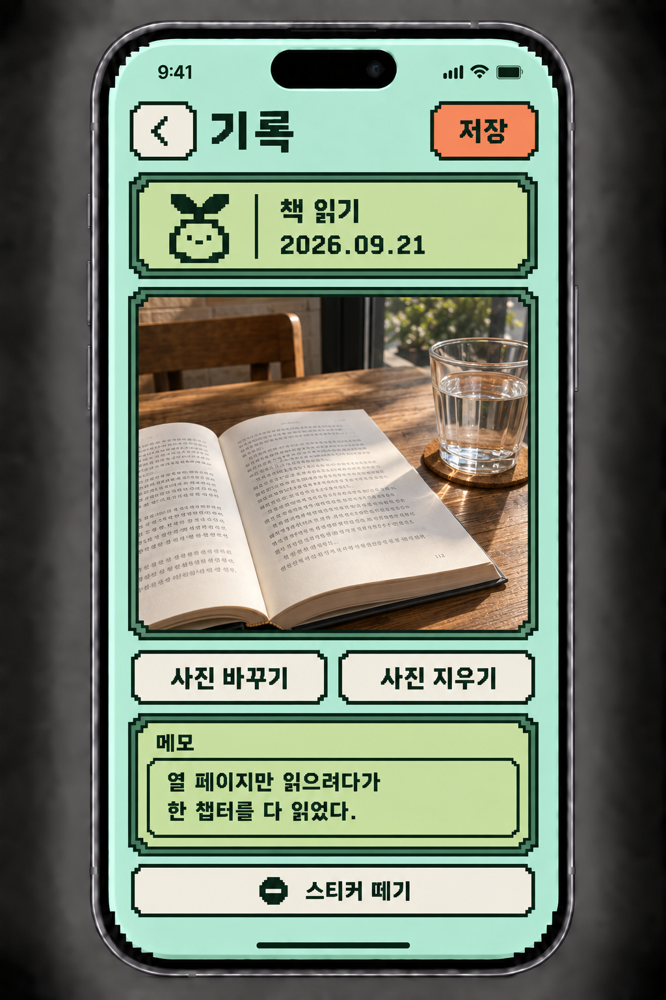
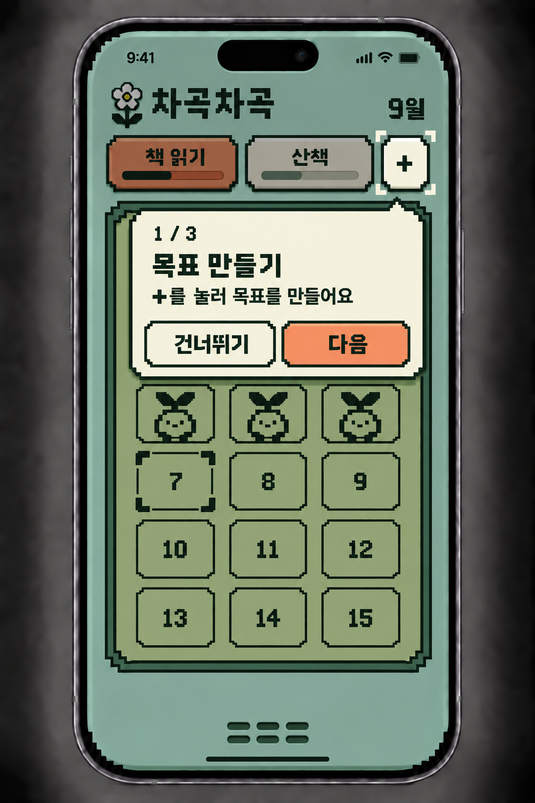
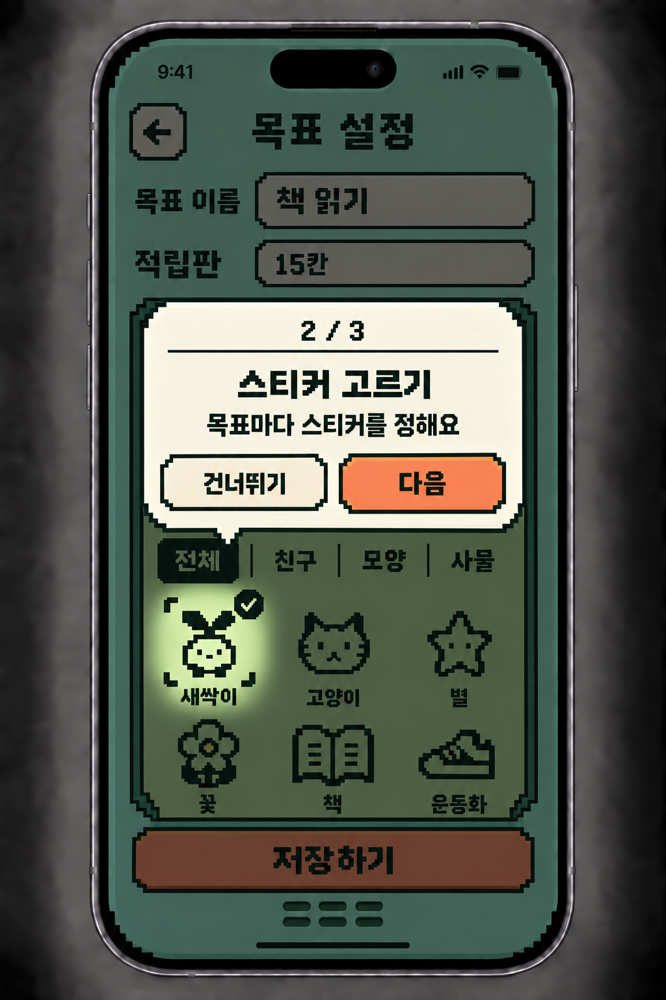
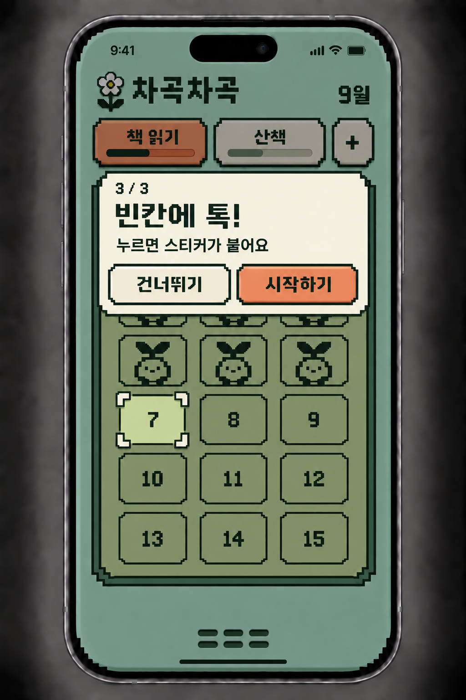

# Retro Pocket · 전체 화면 검토본 01

2026-09-21 · **기본 화면 5개 + 튜토리얼 3장** · 사용자 최종 확정 전 검토용

이 폴더를 현재 전체 화면 검토의 진입점으로 사용한다. 과거 revision 폴더의 이미지를 섞어서 보지 않는다.
색상·폰트·프레임의 수치 기준은 [디자인 토큰 1.0.1](../system/DESIGN-TOKENS.md)을 유지한다. 새 토큰 변경은 없다.

## 이번에 검토할 것

- 적립판/달력판의 전체 배치와 목표 전환 영역
- 목표 만들기와 기본 스티커 설정 구성
- 사진·메모 기록 화면의 정보 배치
- 3단계 튜토리얼의 순서와 안내 방식

## 기본 흐름

튜토리얼 1 → 2 → 3 → 사용자 홈 → 새 목표 만들기 → 적립판 또는 달력판.
홈의 톱니/기본 스티커 → 목표 설정 → 저장 후 홈.
홈의 붙인 스티커 → 기록 → 저장 후 홈.
튜토리얼에 표시된 목표와 스티커는 설명용 예시이며 실제 기록으로 저장하지 않는다.

## 유지한 방향

- 민트 본체, LCD색 판, 살구색 primary, 아이보리 secondary.
- 상단 목표 이름 + 진행 막대, 계단형 픽셀 프레임.
- 앱 글씨는 도트, OS 상태바는 기본 형태.
- 기본 스티커 라벨 유지, 선택은 목표 설정에서 수행.
- 필터 외곽/개별 테두리 없음, 우측 장식 점 없음.
- 일반 화면의 상시 안내문 없음. 처음에만 튜토리얼.

## 후속 보정 범위

요청에 따라 긴 이름·목표가 많을 때·입력 오류·로딩/실패·키보드/작은 화면 등의 validation 및 예외 상태를 이번 검토에서 제외한다.
목표가 없는 홈과 사진 없는 기록 등 상태 변형도 후속 작업에 둔다.
이는 모든 가능한 상태가 완성됐다는 뜻이 아니라 주요 화면 구성이 한 묶음으로 준비됐다는 뜻이다.
생성 이미지의 정확한 RGB·폰트 파일 일치·스티커 원본 픽셀 일치·컴포넌트 수치 보정은 후속 구현에서 토큰과 공통 자산으로 처리한다. 실제 앱 코드는 변경하지 않았다.

## 화면 목록

- [적립판 홈](screens/01-home-tally.png)
- [달력판 홈](screens/02-home-calendar.png)
- [새 목표](screens/03-new-goal.png)
- [목표 설정](screens/04-goal-settings.png)
- [스티커 기록](screens/05-sticker-record.png)
- [튜토리얼 1 · 목표 만들기](screens/06-tutorial-goal.png)
- [튜토리얼 2 · 스티커 고르기](screens/07-tutorial-sticker.png)
- [튜토리얼 3 · 붙이기](screens/08-tutorial-place.png)

## 적립판 홈

## 달력판 홈

## 새 목표

## 목표 설정

## 스티커 기록

## 튜토리얼 1 · 목표 만들기

## 튜토리얼 2 · 스티커 고르기

## 튜토리얼 3 · 붙이기

